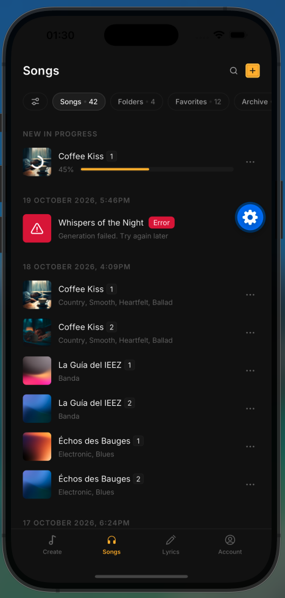
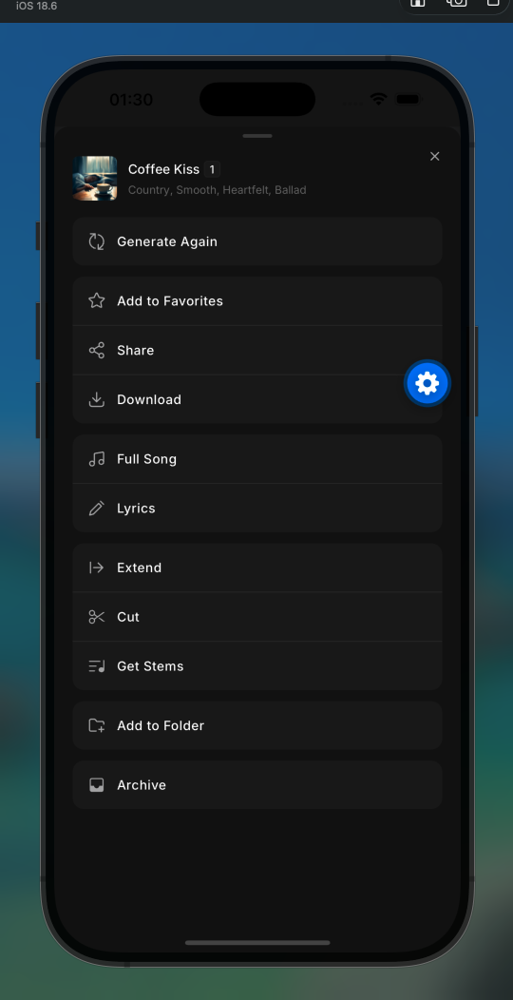

# Songer

The Songs screen of a music-generation app: a list of songs grouped by date, generation progress and error states, a mini player, search and a song actions bottom sheet.

<p>
  
  
</p>

## Stack

Expo SDK 58, React Native 0.88, TypeScript, Expo Router, Reanimated 4, @gorhom/bottom-sheet, FlashList v2, expo-audio, expo-image, TanStack Query, Zustand.

`songs.json` acts as a remote backend: only `src/api/` reads it, through paginated endpoints with simulated latency.

## Getting started

```bash
npm install
npx expo start      # needs a dev build for native modules
```

```bash
npm run typecheck
npm run lint
```

## Structure

```
src/
  app/         # Expo Router routes
  features/    # songs, player, search, song-actions
  components/  # shared UI, icon registry
  api/         # paginated endpoints over songs.json
  core/ theme/ utils/
```
